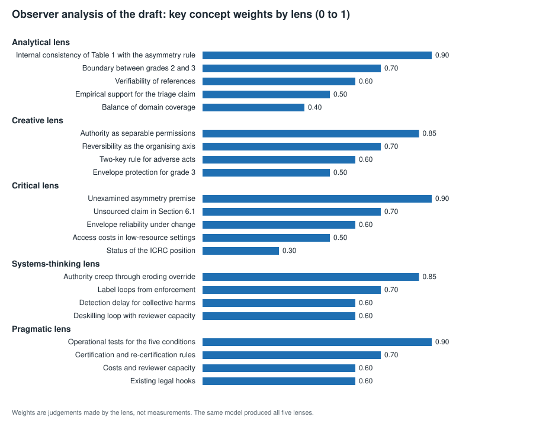
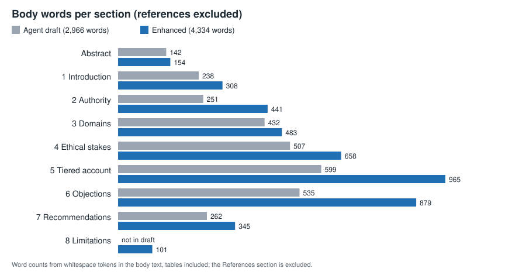
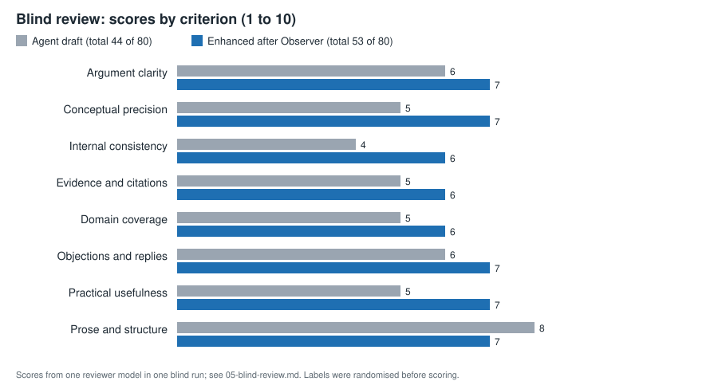

# Stage report: Observer on a paper about AI authority over sensitive decisions

This report records what happened at each stage of the test, with the figures that go with each stage. The test asked three questions. Can an agent write a credible ethics paper on giving AI authority over sensitive human decisions in medicine, the military and the economy? Does the Observer method improve that paper? Can a blind reader see the difference? Every number here comes from a file in this folder. The known defects in the enhanced paper were left in place on purpose, and section 9 lists them.

## 1. Overview

The table gives each stage, what happened, its output and its headline figure. The diagram after it shows the order.

| Stage | What happened | Output | Headline |
|---|---|---|---|
| 0 Setup | Skill loaded, test question and seed fixed | none | seed 20261021 |
| 1 Draft | A general-purpose agent wrote the paper | 01-agent-draft.md | 2,966 body words, 13 references |
| 2 Observer | Five lenses and the Higher-Order Observer run on the draft | 02-observer-analysis.md | confidence 62 of 100 |
| 2b Enhancement | Six recommendations applied to the draft | 03-enhanced-paper.md | 4,334 body words (+46%) |
| 3 Blind review | One reviewer, labels randomised, scores recorded before unblinding | 05-blind-review.md | 44 against 53 of 80 |
| 4 Visuals | Three figures and change statistics | fig-*.svg, stats.json | 127 sentences identical in both versions |
| 5 Reading | Observer findings checked against the reviewer's audit | sections 8 and 9 of this report | Observer found 3 of 8 draft defects |
| 6 Publication | Ten files placed on a new branch of kalatehjari/Observer | case-studies/ai-authority-sensitive-decisions/ | no pull request |

~~~mermaid
flowchart LR
    S0["0 Setup skill loaded, question fixed, seed 20261021"] --> S1["1 Agent draft 01, 2,966 body words, 13 references"]
    S1 --> S2["2 Observer 02, five lenses and synthesis, confidence 62"]
    S2 --> S2b["2b Enhancement 03, six recommendations, 4,334 body words"]
    S2b --> S3["3 Blind review 05, labels X and Y, 44 against 53 of 80"]
    S3 --> S4["4 Visuals three SVG figures, stats.json"]
    S4 --> S5["5 Reading defects kept, limits stated"]
    S5 --> S6["6 Publication new branch, no pull request"]
~~~

## 2. Stage 0: setup

The test used the observer-multi-lens-reasoning skill, in the version saved earlier in this work. Its procedure has four parts. The question is framed. Five lens streams each produce a reasoning chain, weighted concepts and a mind map. A Higher-Order Observer synthesis compares the streams and gives a recommendation with a confidence score. A transparency report closes the analysis. The question put to the method was how the draft should be revised, and how confident one can be in its central recommendation.

Two things were fixed before any output was read. The first was the random seed for the blind assignment, 20261021. The second was the key that links the labels X and Y to the two versions. The key was kept in a private folder, outside the materials the reviewer saw, and it is not part of this upload.

## 3. Stage 1: the agent draft

A general-purpose agent was asked to write an ethical paper on giving AI authority over highly sensitive human decisions in medicine, the military and the economy. It returned a 155-line Markdown paper (01-agent-draft.md) with an abstract, seven numbered sections and 13 references, at 2,966 body words. The central proposal is a five-grade scale of authority, from information (grade 0) to autonomous execution (grade 4), with a ceiling on that scale for each decision class. Authority above advice is licensed only when five conditions hold: answerability, contestability, right target, real override and bounded delegation. The paper's main ethical premise is an asymmetry: errors that move a person toward benefit count as cheaper than errors that withhold benefit.

The checks on this stage were partial. The section structure was confirmed. Of the 13 references, 12 matched a title or identifier in this case study's searches, and four of those matches went only as far as title and author. Venues and page numbers for several entries were not confirmed, and section 9 names them.

Three defects were present before any test was run. Table 1 gives credit refusals the same grade-2 ceiling as approvals, which contradicts the paper's own rule that adverse steps need a human decision-maker of record. Section 6.1 says, without a source, that most of the triage benefit comes from escalation. And the economic case, the Robodebt scheme, ran on a fixed income-averaging rule rather than a learned system, so it is weak evidence about AI.

## 4. Stage 2: the Observer analysis

The Observer pass read the draft alone. The five lenses were worked in one pass, in the order the skill gives, each from the draft text rather than from another lens's output. Each lens produced a reasoning chain of labelled steps, three to five weighted concepts with a one-line reason for each weight, and a mind map. The mind maps are Mermaid diagrams in 02-observer-analysis.md, because that file goes to a repository that renders them, which is the condition the skill sets for Mermaid.

The Higher-Order Observer found four convergence zones. The strongest, C1, is that the credit row contradicts the asymmetry rule and Section 6.4. Three lenses reached it from the same text, so it is a finding about the text, not evidence from outside it. Three productive divergences followed. D1 sets precision against usability: whether authority should be split into separate permissions, or kept as a three-level ladder that institutions can certify. D2 asks whose errors count, which is a values question about how much harm to third parties should weigh. D3 sets protection against access, the cost of strict ceilings in low-resource systems. The recommendation was to keep the framework and make six revisions. Confidence in the draft's central recommendation was 62 of 100, and the analysis estimates that the revisions would raise it to about 68. The analysis says that figure is an estimate, not a measurement.

Figure 1 shows the concept weights. The three highest weights, 0.9, fall one each on the analytical lens (the internal consistency of Table 1), the critical lens (the unexamined asymmetry premise) and the pragmatic lens (operational tests for the five conditions).

## 5. Stage 2b: the enhanced paper

The enhancement applied the six recommendations from 02 to the draft and produced 03-enhanced-paper.md. Each change can be traced to a recommendation. Credit refusals now sit at grade 1, with grade 2 only under a statute that sets review capacity and audit. The asymmetry premise is stated as a values choice with a condition under which it should be reversed, and where the ordering is unsupported the default is grade 1. The unsourced claim in Section 6.1 became an open empirical question. The five conditions have a table (Table 2) that gives each one a test, a certifying body and a re-check interval. Drift and cost have new treatment. Section 4.6 covers feedback, drift and detection, Section 5 sets downgrade triggers, Section 6.5 replies on third-party harm, and Section 6.6 replies on low-resource settings. A new Section 8 states the limits, including that the military discussion is policy-level and that the ICRC position is a non-binding recommendation. Volumes and page numbers were added to the reference list.

Figure 2 shows where the growth went. The enhanced body is 4,334 words, 46 percent more than the draft's 2,966.

The enhancement was not run through Observer a second time, and it introduced problems of its own. Table 2 was placed before Table 1, and several new passages contradict each other. Section 9 lists them. Some volume and page details in the reference list were added from memory, and the checks confirmed only part of them.

## 6. Stage 3: the blind review

The two versions were copied into a review folder as Paper X (the draft) and Paper Y (the enhanced paper), and the reviewer saw only those two copies. The assignment came from the seed set in Stage 0, and the key was opened only after the scores were recorded. One reviewer ran on the opus model, as a general-purpose agent that had written neither paper and had no access to the analysis files. It was asked to judge the arguments rather than the length, and to spot-check up to two references per paper with web search. Blinding was partial, because the enhanced paper has an extra section and more text, so a reader may recognise it.

Figure 3 shows the scores. The enhanced paper scored higher on seven of the eight criteria. The exception was prose and structure, where the draft scored 8 and the enhanced paper 7. The totals were 44 for the draft and 53 for the enhanced paper, out of 80. The largest gains, two points each, were in conceptual precision, internal consistency and practical usefulness. The reviewer preferred Paper Y. Its reason was that the draft's Table 1 contradicts its own asymmetry principle, and that the enhanced paper fixes this and turns the principle into a premise that can be tested.

The reviewer recorded eight defects in the draft: three contradictions and five unsupported or incorrect claims. Section 4 of 05-blind-review.md lists 22 numbered findings, F1 to F22, drawn from the reviewer's report, and checks each against both versions. The Observer pass flagged three of the eight draft defects, the credit row, the asymmetry premise and the Section 6.1 claim, and the enhancement fixed all three. The other five were not flagged and were not fixed. They include the statute exception that conflicts with the welfare ceiling, the grade-4 protective stop, and the overgeneralised use of Eubanks. Against the enhanced paper, the reviewer recorded ten new problems introduced by the revision, plus a new wording problem in an existing finding (F3).

## 7. Stage 4: visuals and statistics

The three figures were written directly as SVG code. SVG is plain text, so GitHub displays the figures without conversion, and each carries its own source note. The file stats.json holds the counts behind the text. The draft has 194 sentences and the enhanced paper 249. Of these, 127 appear word for word in both, which is about 65 percent of the draft's sentences and 51 percent of the enhanced paper's. Sentence counts depend on how the text is split, so treat them as approximate. The word similarity of the two bodies, measured with difflib's SequenceMatcher over their words, is 0.735.

The growth is uneven. Section 2, "What authority means", grew by 76 percent, Section 6 by 64 percent and Section 5 by 61 percent. Section 3, on the three domains, grew least, by 12 percent, which fits the reviewer's view that the military case is still the thinnest. Section 8 is new at 101 words. These figures describe the text and do not measure its quality. The increase in length is the main confound in the comparison, and section 8 returns to it.

## 8. Stage 5: what the test shows

On the reviewer's criteria, the enhanced paper is better, and the changes follow the Observer findings closely. Observer found three of the eight draft defects, the revision fixed those three, and the total rose from 44 to 53. That is consistent with the skill helping. It does not show that the skill helped, for four reasons.

First, there was no control. No plain revision of the draft, made without Observer, was produced for comparison, so the test cannot separate the method from the effect of any careful rewrite. Second, the enhanced paper is 46 percent longer. The reviewer said length may have moved some scores, although it credited added material only where it changed the argument. Third, Observer missed five of the eight draft defects, and the revision introduced ten new problems. A second Observer pass with a consistency check would probably have caught several of them, and that pass was not run. Fourth, the draft, the five lenses and the reviewer all come from Claude models, so their agreement is not independent evidence. The test also had one reviewer, one run, and a 1-to-10 scale that was not calibrated.

The main lesson concerns the procedure more than the result. The skill has no step that checks a revised text against itself. Several of the new problems are internal contradictions or mismatches (F6, F12, F13 and F16), which is the kind of error a consistency pass is designed to catch. Observer's other points, on authority creep, label loops, operational tests and third-party costs, were not in the reviewer's list of defects, because the reviewer looked for what was wrong rather than what was missing. Those additions appear in the enhanced paper, and the reviewer credited them where they changed the argument.

## 9. Known defects, left in place

The enhanced paper still has the problems listed below. The finding numbers in brackets refer to 05-blind-review.md.

Some contradictions remain. The statute exception in Recommendation 2 applies to all adverse decisions, but welfare denials are capped at grade 1 with no exception (F2). The grade-4 protective stop is defined as having no timely human veto and limits set by the system, yet the stop as described can be countermanded by a clinician at once and has limits set by designers (F3). Section 4.6 says flagged cases lead to investigations, while Section 5 says a flag "costs little if it is wrong" (F6). Section 5 says authority is licensed only when five conditions hold, and Section 6.6 says a low-stakes service "needs fewer of them" (F12). Section 4.6 says "Two dynamics are missing" and then describes a third (F13). Table 2 comes before Table 1 (F14). Section 6.1 repeats its conclusion, and its second reply does not engage the conditional in the objection (F7).

Several claims and gaps remain. Certification of real override is by internal audit, so the deploying organisation checks its own override (F9). Grade 1 has no tests in the conditions table (F10). The thresholds are left to certifying bodies, with no method for setting them (F11). The high-volume case is still open, because grade 1 is not workable at volume either and is exposed to automation bias (F8, partly fixed). The claim that market harms are detected late does not allow for some harms that are visible within minutes, as the reviewer noted of the 2010 Flash Crash (F15). The definition of a decision about a person names "access to a service", which strains the exclusion of queue position (F16). Robodebt was automated by a fixed rule, not by a learned system (F17). The military case is hypothetical and thin, and neither version takes on the argument that machines might apply humanitarian rules more consistently than people (F18). The line that one flawed label distorts every decision omits that a corrected label corrects every decision at once (F19). The Eubanks claim is overgeneralised (F20). The line that no one can answer for a collective harm conflicts with the answerability test, which needs only a named institution and person (F21).

The citations need work too. The venue for Matthias (2004) is unconfirmed. Page numbers for several entries came from memory. For Parasuraman and Manzey (2010) the reviewer confirmed the title, the first author and the DOI, but not the pages. For Sparrow (2007) it confirmed the author, the year and the journal, and found a listing that gives volume 24, but not the pages (F22). The AI Act entry links to a secondary site rather than to the Official Journal.

Before this report was written, one count in 05 was corrected. The audit had said the enhancement fixed four draft items. Its own table shows three fixed in full, one fixed only for the credit case, and one improved but not fully verified, so the sentence now says so.

These defects were left in place because the test compares the enhanced paper as it stands, and correcting them now would change the object under test. They are the material for the next step, a second Observer pass with a consistency check, which has not been run.

## 10. What was not done

No second Observer pass was run, and no control arm was produced. Token use was not metered by stage, so the cost of the method is unknown. Reference checks were partial. The Obermeyer relabelling figure that the reviewer cited, which runs from 17.7 to 46.5 percent, could not be confirmed, so it is not used anywhere in this case study. No clinician, lawyer or military ethicist reviewed the paper, and nothing in it is professional advice. The military and Robodebt examples are illustrations, not evidence about how any system performs.

## 11. Publication

The ten files in this folder are placed on a new branch of kalatehjari/Observer, named case-study/ai-authority-sensitive-decisions, in the folder case-studies/ai-authority-sensitive-decisions/. No pull request is opened and nothing is merged. Pushes from the container were refused by the proxy earlier in this work, so the upload goes through the logged-in Chrome session, as the user directed. The browser's file input could not read files from the container, so each file is passed to the GitHub page as text in chunks, and each chunk is checked against its CRC-32 before the commit. The checksums are listed in README.md, so anyone can check that the files on GitHub match the files described here. The review-pool copies and the private key are not uploaded. The pool duplicates files 01 and 03, and the key stays private.

## 12. Where this leaves the test

The test supports a narrow claim. The Observer pass found the draft's most important defect, and the revision fixed it. The revision also introduced new defects that the method did not look for, and the test had no control. The next useful step is a second Observer pass on 03 with a consistency check added to the procedure, then a control arm and a second reviewer.
