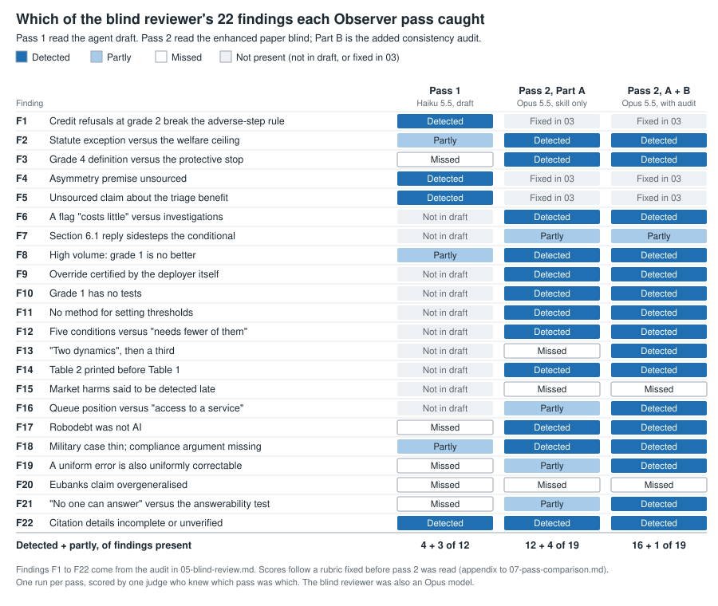

# Comparing the two Observer passes

This file compares the first Observer pass, run on the agent draft (02-observer-analysis.md), with a second pass run blind on the enhanced paper (06-observer-second-pass.md). It sets out what each pass was given, how much of the blind reviewer's list of defects each one caught, what the second pass found that the reviewer did not, and what the differences can and cannot be put down to. The scoring rubric was written before the second pass had produced any output, and it is reproduced in the appendix.

~~~mermaid
flowchart LR
    D["01 Agent draft"] --> P1["02 Pass 1 Haiku 5.5"]
    P1 --> E["03 Enhanced paper"]
    E --> R["05 Blind review 22 findings"]
    E --> P2["06 Pass 2 Opus 5.5, max effort, blind"]
    P1 --> C["07 This comparison"]
    R --> C
    P2 --> C
~~~

## 1. The two passes

| | Pass 1 | Pass 2 |
|---|---|---|
| Model | claude-haiku-5-5, as the session was configured at the time; the serving model was not recorded separately | claude-opus-5-5 at max effort, as the agent recorded in the first line of its output |
| Context | The main session, which had also briefed the draft and knew the test design | A fresh agent, told to read nothing but the paper and the skill |
| Input | 01-agent-draft.md | 03-enhanced-paper.md, copied byte for byte (29,515 bytes, CRC-32 c1122050) and checked again after the run |
| Method | The skill as saved | The same skill file (SHA-256 3dff7bd6...), followed by two additions: a consistency audit and a check of up to four references (Part B) |
| Question | How should the draft be revised, and how confident can we be in its central recommendation? | The same question, worded for "this paper" |
| Length | 2,969 words | 14,562 words: 7,847 in Part A and 6,715 in Part B |
| Revisions proposed | 6 | 13, in three tiers: must fix, should fix and polish |
| Convergence zones and divergences | 4 and 3 | 8 and 7 |
| Quotations of the paper | 2, both exact | 208, all exact, plus two that quote the question rather than the paper, as the pass itself notes |
| Confidence in the central recommendation | 62, with about 68 estimated after revision | 62, with about 74 estimated after revision |
| Cost | Not metered | About 312,000 tokens, 16 tool calls and 34 minutes |

## 2. The short answer

The second pass found far more than the first, and what it found holds up. Of the 19 reviewer findings still open in the enhanced paper, its standard part (Part A) detected 12 and partly detected 4 more. With the consistency audit (Part B), it detected 16 and partly detected 1. All 175 quotations in the audit match the paper word for word. It also raised 30 problems that the reviewer did not list. Checked against the paper, 27 of them hold, 3 are matters of convention or reading, and none is wrong.

The fairest single comparison uses the nine reviewer findings that exist in both versions of the paper. Reading the draft, pass 1 detected one of them and partly detected three. Part A of pass 2 detected six and partly detected two, and with the audit it detected eight. A second comparison points the same way. The second pass found eleven problems in passages that appear word for word in both versions. Pass 1 read those passages and flagged none of them. Part A of pass 2, which uses only the standard skill, found seven of them and partly found an eighth.

Both passes put their confidence in the central recommendation at 62. Pass 1 expected its six revisions to raise that to about 68. Reading the revised paper blind, pass 2 still put it at 62, and it named the internal contradictions as the largest drag it could correct. Thirty of its 35 consistency problems quote at least one passage that the first revision added or reworded.

The design cannot apportion the difference between the model, the effort budget, the input and the added audit. Section 9 sets out what it can and cannot separate. The second pass cost about 312,000 tokens and 34 minutes, and its output is about five times as long as the first.

## 3. Detection against the blind review

The reference is the list of 22 findings, F1 to F22, in section 4 of 05-blind-review.md. The enhancement fixed three of them (F1, F4 and F5), so 19 are open in the enhanced paper. It introduced ten (F6, F7 and F9 to F16), so those did not exist when pass 1 read the draft. Each pass is scored only on the findings present in the text it read, which leaves 12 for pass 1 and 19 for pass 2.

A finding counts as detected when the pass names the same problem. It counts as partly detected when the pass points at the right passage or the right general problem but misses the specific conflict. Otherwise it is missed. The criteria for each finding are in the appendix. They were written for pass 2 before its output existed. The same criteria are applied here to pass 1, and its results for F1, F4 and F5 are taken from the audit in 05.

| ID | Finding | Pass 1 (draft) | Pass 2, Part A | Pass 2, Part A + B |
|---|---|---|---|---|
| F1 | Credit refusals at grade 2 break the adverse-step rule | Detected | Fixed in 03 | Fixed in 03 |
| F2 | Statute exception versus the welfare ceiling | Partly | Detected | Detected |
| F3 | Grade 4 definition versus the protective stop | Missed | Detected | Detected |
| F4 | Asymmetry premise unsourced | Detected | Fixed in 03 | Fixed in 03 |
| F5 | Unsourced claim about the triage benefit | Detected | Fixed in 03 | Fixed in 03 |
| F6 | A flag "costs little" versus investigations | Not in draft | Detected | Detected |
| F7 | Section 6.1 reply sidesteps the conditional | Not in draft | Partly | Partly |
| F8 | High volume: grade 1 is no better | Partly | Detected | Detected |
| F9 | Override certified by the deployer itself | Not in draft | Detected | Detected |
| F10 | Grade 1 has no tests | Not in draft | Detected | Detected |
| F11 | No method for setting thresholds | Not in draft | Detected | Detected |
| F12 | Five conditions versus "needs fewer of them" | Not in draft | Detected | Detected |
| F13 | "Two dynamics", then a third | Not in draft | Missed | Detected |
| F14 | Table 2 printed before Table 1 | Not in draft | Detected | Detected |
| F15 | Market harms said to be detected late | Not in draft | Missed | Missed |
| F16 | Queue position versus "access to a service" | Not in draft | Partly | Detected |
| F17 | Robodebt was not AI | Missed | Detected | Detected |
| F18 | Military case thin; compliance argument missing | Partly | Detected | Detected |
| F19 | A uniform error is also uniformly correctable | Missed | Partly | Detected |
| F20 | Eubanks claim overgeneralised | Missed | Missed | Missed |
| F21 | "No one can answer" versus the answerability test | Missed | Partly | Detected |
| F22 | Citation details incomplete or unverified | Detected | Detected | Detected |
| Totals | | 4 detected and 3 partly, of 12 present | 12 detected and 4 partly, of 19 | 16 detected and 1 partly, of 19 |

### 3.1 Like for like: the nine findings present in both versions

Nine findings exist in both texts: F2, F3, F8 and F17 to F22. Their wording changed little between versions, so they are the closest this design comes to a common test.

| | Detected | Partly | Missed |
|---|---|---|---|
| Pass 1, on the draft | 1 | 3 | 5 |
| Pass 2, Part A | 6 | 2 | 1 |
| Pass 2, Part A + B | 8 | 0 | 1 |

Pass 1's one detection is F22, the citation details. Its three partial detections are F2, F8 and F18. On F2 it saw that Recommendation 2's statute exception was missing from the table, but not that the exception clashes with the welfare ceiling. On F8 it tied high volume to the credit row, but did not ask whether grade 1 works at volume. On F18 it called the military case short, but did not raise the argument that machines might apply humanitarian law more consistently than people. It missed the grade-4 protective stop (F3), and it called the Robodebt case "apt", although the scheme ran on a fixed rule rather than a learned system (F17).

### 3.2 The nineteen open findings, by type

| Type | Findings | Part A: detected | Part A: partly | Part A + B: detected | Part A + B: partly |
|---|---|---|---|---|---|
| Internal consistency and structure | F2, F3, F6, F12, F13, F14, F16, F21 | 5 | 2 | 8 | 0 |
| Unsupported or incorrect claims | F15, F17, F19, F20 | 1 | 1 | 2 | 0 |
| Gaps in the argument or the machinery | F7, F8, F9, F10, F11, F18 | 5 | 1 | 5 | 1 |
| Citations | F22 | 1 | 0 | 1 | 0 |

The audit added four detections: F13, F16, F19 and F21. Three are consistency findings and one is an overstated claim. With them, the second pass caught every consistency finding on the reviewer's list. Its two remaining misses are claims about the world rather than about the text: whether market harms are detected late (F15), and whether the Eubanks sentence overgeneralises (F20). An audit that checks the paper against itself cannot catch either.

### 3.3 A note on re-scoring pass 1

The audit table in 05-blind-review.md marks F22 as not flagged by Observer. Under the rubric used here, pass 1's remarks on the reference list count as a detection, because it named missing venue and page details for Bainbridge, Matthias and Sparrow. The same rubric applies to both passes, so F22 counts for pass 1 here. On the reviewer's own eight draft findings, pass 1's result is unchanged at three detected (F1, F4 and F5), with F2 now counted as partly detected.

## 4. Problems pass 1 could have caught

Eleven of the second pass's 42 items quote only passages that also appear, word for word, in the draft. Five are consistency problems and six are overstated claims. Pass 1 read the same sentences and raised none of them. Seven were already in Part A of pass 2. The audit added three and completed one.

| Item | Problem | Where pass 2 found it |
|---|---|---|
| K4 | Section 2 says the failures of Section 4 arise at advice too; Section 4.5 confines them to grades above advice, and grade 1 carries no conditions | Part A and Part B |
| K16 | Recommendation 6 implies that discretionary AI market interventions may go ahead with public justification, but the ceiling of 1 allows no action | Part A and Part B |
| K24 | The Abstract's "five grades of authority" against "Grades 0 and 1 are not authority" | Part A and Part B |
| K26 | "the grade 1 role of review" names no grade-1 function | Part B only |
| K33 | The roadmap promises "one case per domain", but Section 3.3 has three economic examples | Part B only |
| U1 | No source for the claim that armed forces classify faster than staff can check | Part B only |
| U2 | No source for the claim that a model's reasons are often unavailable to credit applicants | Part A and Part B |
| U3 | No source for the claim that no single person can answer for collective market harm | Part A and Part B |
| U4 | Obermeyer is cited for a system that saves more lives overall, but the study as the paper describes it concerns who was identified for a programme | Part A and Part B |
| U5 | No source for the claim that human bias is heterogeneous, and the paper's own evidence points to correlated bias | Part A and Part B |
| U6 | "One flawed label distorts every decision" ignores that a uniform error can be corrected everywhere at once | Partly in Part A, fully in Part B |

Pass 2 chose this list, so it cannot show what pass 2 itself missed. What it does show is that these problems could be found in the draft and that the first pass did not find them.

## 5. Findings outside the reviewer's list

Thirty of the second pass's 42 items match nothing on the reviewer's list: 25 consistency problems and 5 overstated claims. All their quotations are exact, so each one was checked for whether the stated conflict really follows from the quoted words. Twenty-seven do. The other three are matters of convention or reading rather than errors, and none of the thirty is wrong. Several sit next to a reviewer finding without repeating it: K2 and K3 next to F3, K9 next to F2, K11 next to F8 and K23 next to F7.

| Item | Problem | Severity | Assessment |
|---|---|---|---|
| K2 | No grade-4 system can meet the licensing rule, so the "one exception" licenses what the rule forbids | high | Holds |
| K3 | "Final authority" is never defined, and the thesis rules out what Section 5 licenses | high | Holds |
| K7 | The answerability test leaves out traceability, which Section 4.1 calls the minimal test | high | Holds |
| K9 | The credit-refusal ceiling is shown as 1, but the class may take grade 2 under a statute | medium | Holds |
| K10 | Section 5 makes fit with the workflow enough for grade 2; Section 6.4 makes it one of four requirements | medium | Holds |
| K11 | The high-volume reason given for refusals applies equally to approvals | medium | Holds |
| K12 | "Reversed" describes what is in effect a suspension of the premise | medium | Holds |
| K13 | Two different tests for reversing the premise, and the example of harm to "people other than the applicant" is the applicant | medium | Holds |
| K14 | Section 5 lets the premise be used with some support; Section 6.5 and Recommendation 2 require it to be tested first | medium | Holds |
| K16 | Recommendation 6 implies interventions that the grade-1 ceiling forbids | medium | Holds |
| K17 | Two of the three drift dynamics in Section 4.6 have no trigger | medium | Holds |
| K19 | Escalation is the fallback where review is absent, but escalation needs a reviewer | medium | Holds |
| K20 | The reply on speed rules out only grade 4, and its reason fits the Section 3.2 envelope against persons | medium | Holds |
| K21 | The low-resource reply answers "slower" service when the objection was about no service | medium | Holds |
| K22 | The defensive military row lacks the predictability condition in the ICRC position | medium | Holds |
| K23 | Section 6.1 grants support for grade-3 use, then says lives saved support only augmentation | low | Holds |
| K24 | "Five grades of authority" against "Grades 0 and 1 are not authority" | low | Holds |
| K25 | The body says systems hold authority; the conclusion says institutions do | low | Holds |
| K26 | "The grade 1 role of review" names no grade-1 function | low | Partly: a disparity audit can be read as advice |
| K27 | A recommendation by one organisation is called a coordinated response | low | Holds |
| K28 | Market rules are said to meet tests that are written for persons | low | Holds |
| K30 | The subgroup trigger needs monitoring that the re-check schedule does not provide | low | Holds |
| K31 | The downgrade rule says "its certifying body", but Table 2 names five | low | Holds |
| K33 | "One case per domain", but Section 3.3 has three economic examples | low | Partly: two of the three are brief examples |
| K34 | The conclusion comes before the limitations, and the roadmap omits it | low | Partly: a convention, not an error |
| U1 | No source for the claim that armed forces classify faster than staff can check | | Holds |
| U2 | No source for the claim that a model's reasons are often unavailable to credit applicants | | Holds |
| U4 | Obermeyer is cited for lives saved, which the study as described does not address | | Holds |
| U5 | No source for the claim that human bias is heterogeneous | | Holds |
| U7 | "Errors that no one can detect or contest" overstates, since sampled audit can find them | | Holds |

The most consequential are K2, K3 and K7, because they go to the core of the framework. Under the paper's own licensing rule, no grade-4 system can ever be licensed: grade 4 has no timely veto and its limits are absent or self-set, so it fails both real override and bounded delegation. The thesis cannot be checked against Table 1 while "final authority" is undefined. And the answerability test leaves out the traceability that the paper itself calls the minimal test of answerability.

Part A also made proposals that are not defects as such. It suggests classifying each permission by its effect on the person rather than by its label, so that fraud flags count as adverse. It suggests treating the grades as delegated power while authority stays with the institution, and adding an upgrade path that needs independent, prospective evidence. Its other proposals are independent certification for adverse and lethal classes, attention to observation bias in the evidence the framework relies on, configuration control of grades, and a mapping of the conditions onto existing law. Much of this draws on outside knowledge, such as the SCHUFA judgment, autonomous retinopathy screening, Arkin's argument on civilian harm, Elish on moral crumple zones and the MCAS accidents. Part A marks that knowledge for checking: the word "verify" appears ten times in Part A, against once in pass 1. None of it has been checked in this case study.

## 6. What the second pass missed or got only partly

F15. Section 4.6 says the delay between harm and detection is longer for collective harms such as market failures. The reviewer pointed out that some market harms, such as the 2010 Flash Crash, are visible within minutes, even if attribution takes longer. The second pass accepted the claim and proposed a detection-delay rule built on it.

F20. The reviewer criticised the Eubanks sentence only in the draft, which said that automated tools "profile, police and punish poor people". The enhanced paper hedges it ("can profile and punish poor people"), and the second pass used Eubanks as support rather than questioning it. The audit in 05 marks F20 as present in both versions, so it is scored as a miss here, but it is a weak one.

F7. The second pass said that the paper does not answer the lives-saved objection in its strongest form, and that the third reply in Section 6.1 "answers a weaker argument than the one posed". It did not make the reviewer's point that the second reply sidesteps the "if" in the objection, or that the section repeats its conclusion.

There are three smaller weaknesses. Part A says the downgrade triggers "cover only authority creep", which simplifies the more precise account in K17. The output is long: 3.1 times the length of the paper it reviews (14,562 words against 4,642), and Part A alone is 2.6 times the length of pass 1. And much of Part B repeats Part A with quotations. Of its 35 consistency items, 25 restate a point already made in Part A, 3 extend one (K15, K27 and K28), and 7 are new (K9, K10, K23, K26, K30, K32 and K33).

## 7. Where the problems came from

Thirty of the 35 consistency problems quote at least one passage that is not in the draft, which means that the first revision added or reworded it. That is an upper bound on the revision's share, since a reworded sentence can carry an older problem. The protective stop (K1) is an example: the draft already had it at grade 4, and the revision added the countermand wording that sharpens the conflict. Five problems quote only draft text, and six of the seven overstated claims were in the draft unchanged.

Read with the reviewer's audit, which counted ten problems introduced by the revision, the pattern is consistent. The first enhancement fixed what pass 1 found and created a new layer of inconsistencies in the machinery it added: Table 2, the downgrade triggers, the restated asymmetry premise, and the new replies in Sections 6.5 and 6.6.

## 8. Confidence and calibration

| | Confidence | Its own estimate after revision |
|---|---|---|
| Pass 1, on the draft | 62 | about 68 |
| Pass 2, on the enhanced paper | 62, made up of about 72 for the core bright lines and about 50 for the ceilings and the asymmetry premise | about 74, made up of about 78 for the core and about 68 for the machinery |

The two scores are not measurements of the same thing on the same text. They are judgements by different models on different versions, and their agreement at 62 is a coincidence. Even so, pass 1's forecast can be set against pass 2's independent reading of the revised paper. Pass 1 expected its revisions to add about six points. Pass 2 found the revised paper no more secure than pass 1 had found the draft, and gave its reason: the internal contradictions "are the largest correctable drag on the score".

The blind reviewer, meanwhile, scored the revised paper higher, 53 against 44 out of 80. The reviewer judged the paper as a piece of work, while the Observer score is confidence that the central recommendation is right. Both readings can hold at once. The revision made the paper better without making its recommendation more secure, because the new machinery brought new contradictions. Pass 2 also splits its score into the core position and the machinery, which shows where the uncertainty lies. Pass 1 gave a single number.

## 9. What the difference can be put down to

Six things changed between the two passes at once:

1. The model: Haiku 5.5 for pass 1, Opus 5.5 for pass 2.
2. The budget: pass 2 ran at max effort for about 34 minutes, and pass 1's budget was not recorded.
3. The input: the enhanced paper is 46 percent longer and adds a conditions table, downgrade triggers and new replies, so it has more places in which to contradict itself.
4. The method: pass 2 added the consistency audit and the reference check.
5. The context: pass 2 was a fresh, blind agent, while pass 1 ran in the session that had briefed the draft.
6. The brief: pass 2 was asked for exact quotations, numbered items and severities.

The evidence separates some of these. The audit's own contribution can be measured inside pass 2. It raised seven consistency problems that Part A had not mentioned, one of them a reviewer finding (F13), and it turned three partial detections into full ones (F16, F19 and F21) by quoting the conflicting passages.

The model, the budget and the brief cannot be separated from one another, but together they explain more than the audit does. Part A, without the audit, found six of the nine shared reviewer findings against pass 1's one. It also found seven of the eleven problems in unchanged draft sentences, against pass 1's none.

The input explains much of the volume, since 30 of the 35 consistency problems involve revised text. It does not explain the like-for-like gap, which was measured on text that both passes read.

Four further runs would close the remaining gaps:

- a same-input run: Opus 5.5 at max effort, using the standard skill on the draft, compared directly with pass 1;
- a same-model run: Haiku 5.5 with the consistency audit, on the enhanced paper;
- replication, since each pass was run once;
- an independent judge, as section 11 explains.

## 10. What this suggests for the skill

The consistency audit earns its place. On this paper it found every consistency problem on the reviewer's list, it quoted every passage exactly, and it caught slips that the standard pass missed. The step is simple to state: check every rule, definition and condition against every table row, example, recommendation, reply and cross-reference, and quote both passages for each conflict.

The audit matters most after a revision. Most of the problems found here sat in text that the first revision added. A loop that analyses the paper, revises it, and then audits the revision would have caught them before the blind review did.

Exact quotation makes a pass checkable. Pass 2's 208 exact quotations allowed every claim in its audit to be verified by machine, and pass 1's two did not allow that.

The remaining misses need a different check. F15 and F20 concern whether claims are true of the world, which no internal audit can settle. A short evidence step, searching each empirical claim the paper relies on, would complement the audit.

Depth has a cost. At max effort, the pass ran to 14,562 words and about 312,000 tokens. The skill could ask for a short lead section, with the must-fix revisions and the high-severity items, and put the rest in an appendix.

## 11. Limits of this comparison

Each pass was run once, and the design is confounded in the ways section 9 describes. The scoring was done in the main session, by then running on Opus 5.5, which knew which pass was which. The rubric was fixed in advance, but one judge applied it. The reference list came from a blind reviewer that was also an Opus model, so it may share the emphases of the Opus pass. The validity checks on the thirty new findings rest on reading the quoted passages, not on expert review. The outside knowledge in Part A is unverified. No clinician, lawyer or military ethicist has reviewed either pass, and nothing here is professional advice.

## 12. Files

| File | What it holds | Bytes | CRC-32 |
|---|---|---|---|
| 06-observer-second-pass.md | The second pass, exactly as the agent wrote it | 93334 | 3d2698b9 |
| 07-pass-comparison.md | This comparison | not listed | not listed |
| fig-pass-detection.svg | The detection matrix shown in section 3 | 19951 | 480fafc1 |
| pass-comparison.json | The scores, the counts and the run details behind this file | 4751 | 295519e6 |

The copy of the paper that the agent read was byte-identical to 03-enhanced-paper.md before and after the run. This file cannot list its own checksum.

## Appendix: the scoring rubric, as written

The rubric was saved at 07:21:07 NZDT on 21 October 2026. The second pass saved its output at 07:54:10 the same morning. The text below is unchanged, except that its headings are one level lower.

Written before any second-pass output existed. The file system timestamp of this file is the record of that.

### Reference set

The reference set is the blind reviewer's findings in 05-blind-review.md that are still open in the enhanced paper (03-enhanced-paper.md). That is every item except F1, F4 and F5, which the enhancement fixed. F8 and F22 were only partly fixed, so they count as open. The set therefore has 19 items: F2, F3 and F6 to F22.

### Scores

- Detected: the second pass names the same problem, either in the same passage or by quoting the conflicting text, even if it words the problem differently.
- Partly: the second pass points at the right passage or the right general problem but misses the specific conflict, or catches only one part of a two-part finding.
- Missed: neither.

Each item is scored twice: once for Part A (the standard Observer pass) and once for Part A plus Part B (with the consistency audit). Part B can add detections but cannot remove them.

### Criteria by item

- F2. Recommendation 2's statute exception allows grade 2 for adverse determinations, but Table 1 caps welfare denials, debt raising and sanctions at grade 1 with no statutory exception. Detected if the mismatch between Recommendation 2 (or the credit row's statute exception) and the welfare row is named. Partly if the statute exception is criticised without the welfare conflict.
- F3. The grade 4 definition ("no timely human veto"; limits "absent or set by the system itself") does not fit the protective stop, whose limits are set by designers and which a clinician "can countermand at once". Detected if either half of this conflict is named for the protective stop.
- F6. Escalation "costs little if it is wrong", but Section 4.6 describes flags that lead to investigations. Detected if the cheapness of escalation or flags is challenged with the investigation point, harm to the person flagged, or the zero-sum queue. Partly if escalation is questioned only in general terms.
- F7. Section 6.1's second reply does not engage the conditional in the objection, and the section repeats its conclusion. Detected if the sidestep of the conditional is named. Partly if only the repetition is named.
- F8. Section 6.4 sends high-volume settings to grade 1, but grade 1 is no more workable at volume and is just as exposed to automation bias. Detected if the problem with falling back to grade 1 (workability at volume, or automation bias at grade 1) is named.
- F9. Real override is certified by internal audit, so the deploying organisation certifies itself. Detected if the self-certification, or the lack of independence for this condition, is named.
- F10. The conditions table tests only grades 2 to 4, and grade 1 (advice) has no tests even though advice shapes decisions. Detected if the missing tests or controls for grade 1 are named.
- F11. Thresholds are left to certifying bodies with no method for setting them. Detected if the missing thresholds, or the missing method for setting them, is named.
- F12. Section 5 says authority is "licensed only when five conditions hold", but Section 6.6 says a low-stakes service "needs fewer of them". Detected if this conflict is named.
- F13. Section 4.6 says "Two dynamics are missing" and then describes a third. Detected if named.
- F14. Table 2 appears before Table 1 in Section 5. Detected if the order or the numbering of the two tables is named.
- F15. Section 4.6 says collective harms in markets are detected late, but some market harms are visible within minutes, while attribution takes longer. Detected if the detection-delay claim for markets is challenged.
- F16. The definition of "decision about a person" includes "access to a service" but excludes queue position, which can decide access. Detected if this tension is named.
- F17. Robodebt used a fixed income-averaging rule, not AI in the sense of learned systems. Detected if named.
- F18. The military case is thin and hypothetical, and the paper does not address the argument that machines might apply humanitarian law more consistently than people. Detected if that missing counterargument is named. Partly if only the thinness of the military case is named.
- F19. "One flawed label distorts every decision" omits that a corrected label also corrects every decision at once. Detected if the symmetric point (a uniform error is also uniformly correctable or auditable) is named.
- F20. The Eubanks-based claim overgeneralises. Detected if that claim is said to overgeneralise or to need narrower wording.
- F21. "No one can answer for a collective harm" (Section 5, market paragraph) conflicts with the answerability test, which needs only a named institution and a named person. Detected if this conflict is named.
- F22. Citation details are incomplete or unverified, for example the Matthias venue, page numbers, or the secondary source used for the AI Act. Detected if specific citation problems are named. Partly if there is only a general call to verify references.

### Findings outside the reference set

Anything in the second pass that matches none of the 19 items is checked against the paper text and marked valid, partly valid or not valid, with the reason.

### Quote check

Every passage the second pass puts in double quotation marks as the paper's words is searched for in the paper, after normalising whitespace, quote characters and emphasis markers. The same check is run on pass 1 (02-observer-analysis.md) against the agent draft (01-agent-draft.md).
